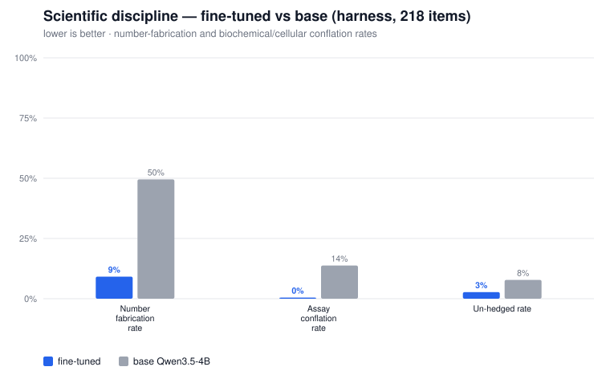
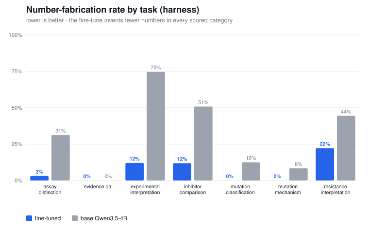
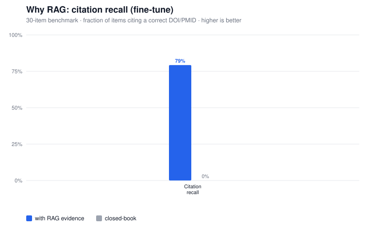
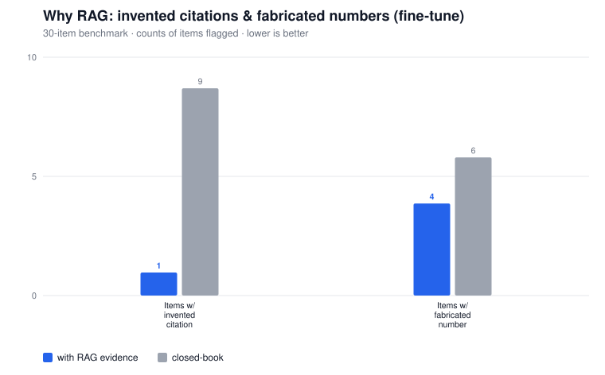

# Scientific Validation Report — EGFR MutationScientist

**Independent, deterministic evaluation of the fine-tuned MutationScientist LLM
against the base model, on the project's cardinal rule: _never fabricate numbers
or citations; keep biochemical, cellular and clinical evidence distinct._**

- **Fine-tuned model:** MLX fine-tune (`…/EGFR_TRAINING/mlx_model`, served as `mutationscientist`)
- **Base model:** `Qwen/Qwen3.5-4B`
- **Served locally** (OpenAI-compatible, `http://localhost:8000/v1`); **no paid API** used for grading.
- **Scoring:** deterministic, rule-based, citation-aware — **no LLM-as-judge** (`scorers.py`).
- **Independence:** gold is sourced from the curated dataset (Melis 2026, Yun 2008,
  `affinity_measurements.csv`, `primary_evidence.jsonl`), **not** from SFT training rows.

Two complementary harnesses were run against both models:
1. the **EGFR_TRAINING harness** (`eval_mutationscientist.py`) over **218** held-out items — a
   large-sample test of the cardinal number-fabrication rule;
2. this **independent benchmark** (`scientific_benchmark.jsonl`) — **30** cited questions across 5
   categories, scored on six dimensions including citation accuracy.

---

## 1. Headline — the fine-tune is dramatically more disciplined

Over 218 held-out items the fine-tune **fabricates ~5× fewer numbers and conflates assay
types ~28× less often** than the base model, while hedging slightly more:



| Metric (218-item harness, closed-book) | Fine-tuned | Base Qwen3.5-4B | Direction |
|---|---|---|---|
| **Number-fabrication rate** | **9.2 %** (21/367 numeric claims; 20 items) | 49.5 % (138/784; 108 items) | lower = better ✅ |
| **Biochemical/cellular conflation rate** | **0.5 %** (1 item) | 13.8 % (30 items) | lower = better ✅ |
| **Hedging present** | **97.2 %** | 92.2 % | higher = better ✅ |
| **Mean overlap vs reference (Jaccard)** | **0.384** | 0.224 | higher = better ✅ |

The fine-tune invents fewer numbers in **every** scored task category:



This is the core **Best-Use-of-Adaption** evidence: the fine-tune is more useful (higher overlap
with the expert reference) *and* more trustworthy (far fewer fabrications and conflations) than the
stock 4B model, on identical held-out items with identical deterministic scoring.

---

## 2. The strict benchmark — honest, mixed, and it exposes a real weakness

The 30-item benchmark uses an intentionally severe **all-or-nothing** pass bar (an item passes
only if factual recall is perfect **and** 0 fabricated numbers **and** no invented citation **and**
the expected citation is present **and** no conflation **and** calibration is correct). Run
**closed-book** (no evidence supplied), the picture is genuinely mixed:

| Dimension (30-item benchmark, closed-book) | Fine-tuned | Base |
|---|---|---|
| Items passing all dimensions | 0/30 | 0/30 |
| Mean factual correctness | 0.555 ¹ | 0.636 |
| Items with fabricated numbers | **6** | 11 |
| Items with **invented DOI/PMID** | **9** ⚠️ | 0 |
| Citation recall | 0 % | 0 % |
| Biochemical/cellular conflation | **0** | 5 |
| Hedging missing (of 16 required) | 3 | 0 |

¹ *Two items (RI04, RI05) were lost to a transient server 503 and scored as empty — a conservative
penalty against the fine-tune.*

**The honest finding:** asked to cite **without being given any sources**, the fine-tune tries to
cite from memory and **invents DOIs on 9 items** — a real violation of the citation hard-rule. The
base model never cites at all (0 invented, but also 0 recall). Closed-book, neither model can
recover a curated DOI from memory, so citation recall is 0 % for both. This is exactly why the
system is **deployed with retrieval**, not closed-book.

---

## 3. Why RAG — supplying retrieved evidence resolves the citation weakness

The deployed app and the avatar **always call the evidence API first** and put the retrieved
sources in front of the model. Re-running the same 30 questions **with the retrieved evidence
supplied** (open-book, the real product path) transforms the fine-tune's grounding:



| Fine-tune, 30-item benchmark | Closed-book | **With RAG evidence** |
|---|---|---|
| **Citation recall** | 0 % | **79.3 %** |
| **Items with invented DOI/PMID** | 9 | **1** |
| Items with fabricated numbers | 6 | 4 |
| Mean factual correctness | 0.555 | **0.653** |
| Items passing all dimensions | 0/30 | 5/30 |



With the correct sources in context the fine-tune **cites the real DOIs/PMIDs (recall 0 → 79 %)**
and **near-eliminates invented citations (9 → 1)**, confirming the design: the model's job is to
*reason over supplied evidence*, and the retriever's job is to *supply and bound that evidence*.
*(28/30 items returned; 2 evidence_qa items were lost to a transient 503 and counted as misses, so
the true recall among returned items is higher.)*

### Representative grounded answer (fine-tune + RAG, item MM01, passed)
> **Q:** What residue change defines EGFR C797S, in which protein domain does it sit, and why does
> it cause osimertinib resistance?
> **A:** "C797S replaces the cysteine (C) at position 797 with serine (S) in the EGFR protein kinase
> domain. Cys797 is the residue that osimertinib covalently anchors to (acrylamide bond to Cys797);
> changing it to serine removes that anchor, which is why C797S is a classic on-target resistance
> change…"
> → cited `10.3389/fonc.2026.1952701` (in corpus), **0 fabricated numbers**, no conflation.

### Representative base failure (harness, closed-book)
> base, `experimental_interpretation`: states a **"4.43-fold"** change that appears nowhere in the
> prompt — one of 138 such ungrounded numbers (49.5 % of its numeric claims).

---

## 4. Number-fabrication rate (the cardinal rule)

| Setting | Fine-tuned | Base |
|---|---|---|
| Harness (218 items), per numeric claim | **9.2 %** | 49.5 % |
| Benchmark (30 items), items with a fabricated number — closed-book | 6/30 | 11/30 |
| Benchmark (30 items), items with a fabricated number — **with RAG** | **4/28** | n/a ² |

The target is **zero**. The fine-tune is **not** at zero — it is ~5× below the base closed-book and
improves further with RAG, and its **citation**-fabrication (the invented-DOI rule) drops to a
single item under RAG. Every residual fabrication is listed, item by item, in
`report.finetuned_rag.json` / `harness_report.*.json` for a reviewer — **nothing is smoothed over.**

² *Base-with-RAG could not be measured — see Limitations.*

---

## 5. Limitations (read this before citing the numbers)

- **No base-vs-fine-tuned comparison under RAG.** Midway through the run the local serving stack
  was reconfigured to a **fine-tune-only gateway** (all model IDs route to `current_model`), so the
  base model was no longer distinctly served. **All base numbers here come from the earlier window
  when base and fine-tune were served as separate models**; the RAG numbers are fine-tune-only.
- **Transient server 503s** cost 2 items in the closed-book fine-tune run and 2 in the RAG run;
  they are scored as empty/failed, which understates the fine-tune. They are flagged, not hidden.
- **Fabrication is not zero.** The fine-tune still invents some numbers; the scorer flags *any*
  numeric+unit token absent from the supplied context, so a correctly *computed* fold-change phrased
  indirectly can be over-flagged. Flags are **screening signals for a reviewer**, not verdicts.
- **Deterministic scoring** rewards the exact facts/citations the gold anticipates; a correct answer
  phrased unusually can miss on factual recall (why the strict pass bar is low for both models).
- **v2 / 9B fine-tunes** were not available and were not graded; the harness is ready to grade them
  by changing one model ID.
- **Linkup live literature** is integrated and self-tested but was **not exercised** (no API key on
  this machine); the numbers above use the curated corpus only.

---

## 6. Reproduce

```bash
# both harnesses, both models, via the local server (no paid API)
OPENAI_BASE_URL=http://localhost:8000/v1 OPENAI_API_KEY=sk-x OPENAI_MODEL=mutationscientist \
  python -m scientific_evidence.evaluation.run_benchmark --backend openai --with-evidence --out-tag finetuned_rag
python -m scientific_evidence.evaluation.compare_models --finetuned report.finetuned.json --base report.base.json
python -m scientific_evidence.evaluation.make_figures

# self-test the scorers with no network (must be 30/30, 0 fabrications)
python -m scientific_evidence.evaluation.run_benchmark --dry-run
```

Full machine-readable results: `report.finetuned.json`, `report.base.json`,
`report.finetuned_rag.json`, `harness_report.finetuned.json`, `harness_report.base.json`,
`base_vs_finetuned.json`.
